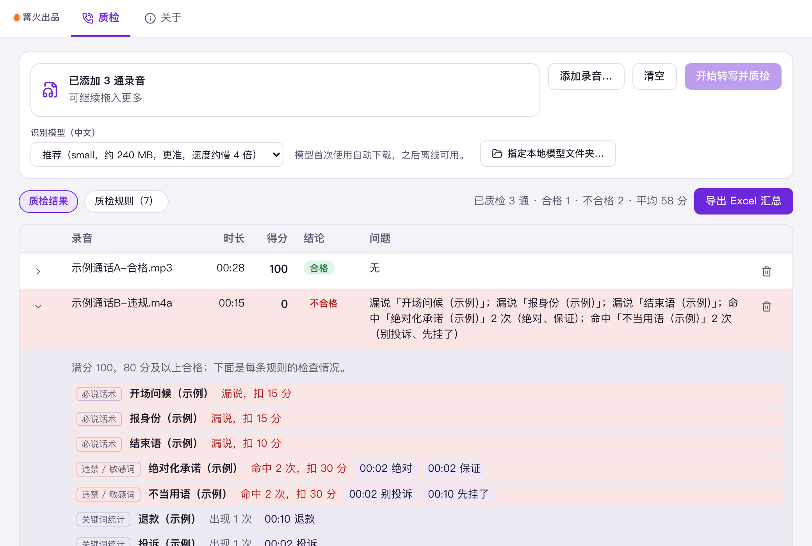

# 电话录音质检

> 篝火出品 · 收录于篝火 App 应用区

批量导入通话录音，在本机离线转成文字后，按你配置的规则质检：必说话术是否说到、违禁词有没有出现、关键词出现几次，每通出得分和命中明细，导出 Excel 汇总。不联网、不用显卡，仅首次使用需要下载识别模型。

**不区分坐席和客户**（不支持说话人区分）：整通录音按一份文字稿检查。**不含 AI 打分**：规则全部是关键词 / 同义词匹配，不调用大模型。



## 下载

到 [Releases](https://github.com/campfire-code/call-qa/releases/latest) 下载对应安装包：

| 电脑 | 文件 |
|---|---|
| Windows 10 / 11 | `call-qa_版本号_windows-x64-setup.exe` |
| Mac（Apple 芯片） | `call-qa_版本号_mac-arm64.dmg` |
| Mac（Intel 芯片） | `call-qa_版本号_mac-x64.dmg` |

第一次打开：
- **Windows**：如果弹出「Windows 已保护你的电脑」，点「更多信息」→「仍要运行」。
- **Mac**：如果提示「无法验证开发者」，打开「系统设置 → 隐私与安全性」，在下方点「仍要打开」。

## 怎么用

1. 把通话录音拖进窗口（或点「添加录音…」）。支持 mp3、m4a、wav、amr、aac、flac、ogg、opus、wma、3gp 等，可一次放很多通，文件不会上传。
2. 切到「质检规则」页配置规则（第一次打开是标了「示例」的示例规则，可直接改、删、加，或点「恢复示例规则」）：
   - **必说话术**（如开场问候、报身份、结束语）：填一组词 / 同义词，任意一个出现就算说了；没说到按「漏说扣分」扣；可限定只认通话前 N 秒内说的。
   - **违禁 / 敏感词**：任意一个出现就按「扣分」扣一次（命中几次都只扣一次），明细里逐处列出时间和那句话。
   - **关键词统计**：统计这组词一共出现几次；默认只统计、不扣分，填了「至少 / 最多」且次数不符时才扣分。
   - 满分 100，扣完为止，不低于「及格分」（默认 80）为合格。词之间用逗号、顿号或换行分隔；匹配时忽略标点、空格和英文大小写。
3. 回到「质检结果」页，选「识别模型」（推荐 small，约 240 MB；base 约 76 MB、更快但错字更多），点「开始转写并质检」。录音按顺序一通一通处理；第一次使用会下载识别模型并校验（SHA-256），之后完全离线。下载不了时点「指定本地模型文件夹…」选手动下载好的模型。
4. 每通录音出得分、合格 / 不合格、问题摘要；点行首箭头看每条规则的检查情况、命中词和时间、完整转写文字（命中违禁词的句子标红）。**改规则后结果立即重算，不用重新转写**。
5. 点「导出 Excel 汇总」，得到一个 .xlsx，含四个工作表：汇总（每通一行，另有每条规则一列的命中次数）、命中明细、转写文字、质检规则（规则快照）。

说明与限制：
- **不区分坐席和客户**。必说话术、违禁词都是在整通录音的文字里找，客户说出来的违禁词也会被命中、客户说的话也可能让「必说」判为已说；实测里音色较弱的一方还可能整句被漏识别。
- 语音识别有同音字误识别（实测把「示例客服中心」识别成「势力客服中心」、「工号」识别成「公号」），所以必说话术要多填同义词和常见误识别；结果只是辅助筛查，请抽查原声。
- 规则只做关键词 / 同义词匹配，不理解语义（例如「不保证」也会命中「保证」）；违禁词表请按自己公司的要求配，内置示例仅用于演示，不代表任何法规或平台要求。
- 识别在本机用 CPU 运行，速度约为录音时长的 0.6 倍（见 c06 离线视频转字幕的实测）；建议单通录音不超过 2 小时。
- 规则保存在本机；Excel 里以 `=` `+` `-` `@` 开头的文字会加前缀，避免被 Excel 当公式执行。
- AMR（手机通话录音常见格式）由随应用附带的 FFmpeg 解码，已核实该 FFmpeg 自带 amr_nb / amr_wb 解码器，并用一个第三方 AMR-NB 文件实测能解码（仓库里没放 AMR 示例，本机没有 AMR 编码器，无法自己合成）。

## 验收用例

`samples/` 里是三通自编的客服通话示例（macOS 自带语音合成，坐席与客户两个声音，不含真实公司、人名、电话），都用默认的示例规则检查（及格分 80）。下面的"应得到"来自 small 模型的一次实测，个别字不同属正常；客户一方的话在实测里被整句漏识别，所以结果只由坐席的话决定。

| 用例 | 操作 | 应得到的结果 |
|---|---|---|
| 合格的通话 | 拖入 `示例通话A-合格.mp3`，点「开始转写并质检」，规则用默认 | 得分 100、「合格」、问题「无」；转写里有「您好，这里是…客服中心，公号 103」（「示例」可能被识别成「势力」，「工号」可能识别成「公号」，规则里已加同义词所以不影响） |
| 违规的通话 | 再拖入 `示例通话B-违规.m4a` | 得分 0、「不合格」；问题含：漏说「开场问候」「报身份」「结束语」，命中「绝对化承诺」2 次（绝对、保证）、命中「不当用语」2 次（别投诉、先挂了）；展开明细，违禁词旁有时间（约 00:02、00:10），转写里对应句子标红 |
| 漏说的通话 | 再拖入 `示例通话C-漏说.wav`（8kHz wav） | 得分 75、「不合格」；问题是漏说「报身份」「结束语」；关键词统计「退款（示例）×3」 |
| 改规则立即重算 | 在「质检规则」里把「报身份」的词加上「请问有什么可以帮您」，回到结果页 | C 的得分变为 90、问题只剩漏说「结束语」；不需要重新转写 |
| 限定时间 | 把「结束语」的「限前 N 秒」改成 10，看 `示例通话A-合格.mp3` | A 变为 90 分、合格，问题为「未按时说「结束语（示例）」」（结束语在约 00:24 才说） |
| 导出 Excel | 点「导出 Excel 汇总」，用 Excel / WPS 打开 | 四个工作表：汇总 3 行（得分 100 / 0 / 75，不合格行结论为红色）、命中明细、转写文字、质检规则（7 条 + 说明） |
| 失败不影响其他 | 同时拖入一个改名为 `.mp3` 的非音频文件 | 该行显示失败原因，其他录音正常；点「重试失败的」可重试 |
| 断网与模型文件夹 | 模型下载完成后断开网络再处理 | 正常出结果，不再下载；选一个缺文件的本地模型文件夹，提示「缺少 onnx/…」 |

### 实测记录

2026-10-23，在 Node（onnxruntime-node，与应用同款 q8 模型 Xenova/whisper-small）里对三通示例的识别结果（语言中文）：

- A：`您好,这里是势力客服中心,公号103,很高兴为您服务。请问是您本人吗?` / `好的,请您提供一下订单号后四位,我帮您查询。` / `已经查到了,订单金天下午发货,…` / `感谢您的来电,祝您生活愉快,再见。`
- B：`喂,请讲。` / `我们的产品绝对没有质量问题,我保证您用了肯定满意,您就别投诉了。` / `退款3-5个工作日到长,没别的是我先挂了。`
- C：`您好,请问有什么可以帮您?` / `退款需要审核,退款到帐一般要3-5个工作日,您的退款已经在审核中了。` / `非常抱歉给您带来补便,我们会尽快处理,请您耐心等待。`

规则打分由单元测试用这些识别结果核对（得分 100 / 0 / 75）。

## 自己编译

需要 Node.js 22、pnpm、Rust。

```bash
pnpm install
pnpm test          # 单元测试
pnpm tauri dev     # 开发运行
pnpm tauri build   # 打包
```

界面框架在 `src/kit`（所有 campfire-code 工具共用），本工具的逻辑在 `src/tool`。

## 致谢

本工具使用 [OpenAI Whisper](https://github.com/openai/whisper)（MIT）的模型权重，经 [transformers.js](https://github.com/huggingface/transformers.js)（Apache-2.0）转换版本在 onnxruntime-web 里运行；繁简转换使用 [opencc-js](https://github.com/nk2028/opencc-js)；Excel 导出使用 [ExcelJS](https://github.com/exceljs/exceljs)（MIT）；音视频处理使用随应用附带的 FFmpeg。完整清单见 [THIRD_PARTY_LICENSES.md](THIRD_PARTY_LICENSES.md)。

## 归属

本工具由**篝火**出品，是篝火 App 应用区收录的开源工具之一，由篝火（GitHub 组织 [campfire-code](https://github.com/campfire-code)）维护与更新。全部工具的目录见 [toolkit-hub](https://github.com/campfire-code/toolkit-hub)。

## 许可证

MIT，版权方为篝火（campfire-code）。
